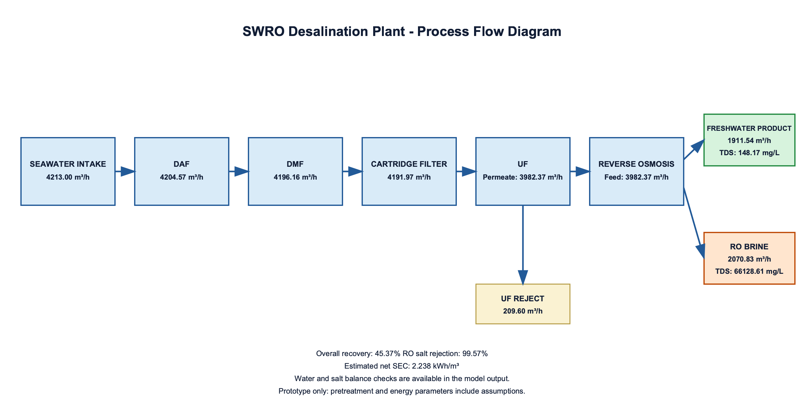

# SWRO Desalination Plant Digital Twin

This directory contains a steady-state MATLAB prototype for the principal stages of a seawater reverse osmosis (SWRO) desalination plant:

`Seawater intake → DAF → DMF → Cartridge filter → UF → RO → Product + Brine`

## Contents

```text
desalination/
├── matlab/
│   ├── SWRO_DigitalTwin_Baseline.mlx
│   └── SWRO_Plant_Flow_Diagram.m
├── images/
│   └── plant_flow_diagram.png
├── results/
│   └── simulation_output.txt
└── README.md
```

The live script contains the baseline mass-balance and energy calculations. Run `SWRO_Plant_Flow_Diagram.m` to reproduce the process-flow image from the reported baseline results.



## Initial Simulation Results

The current MATLAB model simulates the main stages of a seawater reverse osmosis (SWRO) desalination plant.

| Parameter                     | Simulated result |
| ----------------------------- | ---------------- |
| Raw seawater flow             | 4,213 m³/h       |
| UF permeate to RO             | 3,982.37 m³/h    |
| Freshwater product            | 1,911.54 m³/h    |
| RO brine flow                 | 2,070.83 m³/h    |
| Product water TDS             | 148.17 mg/L      |
| Brine TDS                     | 66,128.61 mg/L   |
| Overall plant recovery        | 45.37%           |
| RO salt rejection             | 99.57%           |
| Estimated pump power          | 7,118.81 kW      |
| Estimated ERD recovered power | 2,841.64 kW      |
| Estimated net SEC             | 2.238 kWh/m³     |

### Model validation checks

The calculated RO water balance, RO salt balance, and overall plant water balance errors are all approximately zero.

These checks demonstrate internal consistency of the implemented balance equations. They do not independently validate the physical accuracy of the model.

### Limitations

The model is a steady-state prototype. Pretreatment removal rates, water losses, RO operating conditions, and energy recovery parameters include assumptions. The model has not yet been integrated with live sensors or implemented as a time-updating digital twin.
